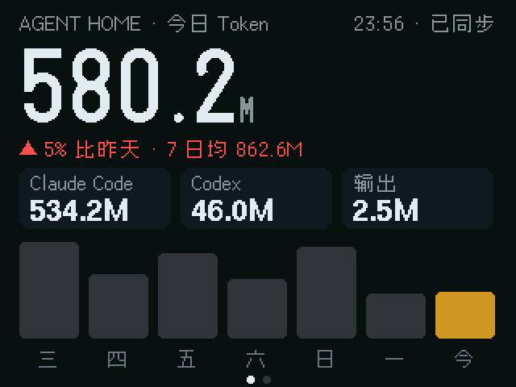
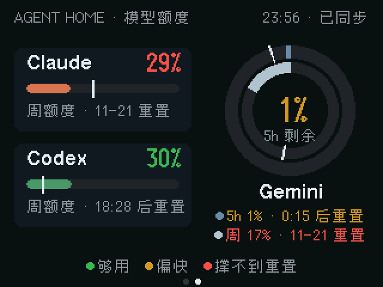

# AgentHome ESP32

English | [简体中文](README.zh-CN.md)

A 2.8" desk screen for your AI coding agents. It shows today's token usage for Claude Code and Codex, and how much Claude, Codex and Gemini subscription quota you have left — colored by whether you will make it to the next reset.

Quota data comes from **[AgentHome](https://github.com/PeterChen1997/agenthome)**, a local macOS app that archives your Claude Code / Codex / Gemini sessions and tracks token usage, cost and quota. This repo is its hardware companion.

| Today's tokens | Quota |
|---|---|
|  |  |

Screenshots are read straight from the device framebuffer (`tools/screenshot.py`, needs Pillow). Tap the screen to switch pages.

## What it shows

**Page 1 · Today's tokens**: today's total (input + output + cache write + cache read), change vs yesterday, 7-day average, Claude Code / Codex / output split, and a 7-day bar chart.

**Page 2 · Quota**
- Claude and Codex: weekly quota (Pro plans are limited by the weekly window). The bar is what's left.
- Gemini: two rings — outer is the 5-hour window, inner is the weekly window. The colored arc is what's left; usage eats it clockwise from 12 o'clock.
- **Pace color** on each percentage: projected usage at reset = used % ÷ elapsed share of the window.
  🟢 under 90% — you're fine · 🟡 90–110% — tight · 🔴 over 110% — you'll run out before the reset. White means the window just started (under 10% elapsed) and the projection isn't reliable yet.
- **White tick**: where "what's left" would be if you spread usage evenly over the window. Colored part short of the tick = burning faster than time.

## Hardware

- **LCDwiki ES3C28P**: ESP32-S3 (16 MB flash, 8 MB PSRAM) with a 2.8" ILI9341 320×240 IPS panel and FT6336 capacitive touch. Connected to the Mac over USB-C; no Wi-Fi needed.
- Other ESP32-S3 + ILI9341 boards work too: change the pin `#define`s at the top of `firmware/agent-home/agent-home.ino`. The firmware writes the vendor's IPS gamma table (`applyVendorPanelTuning`); drop it if your panel is a TN one. A PSRAM board is required for the full-screen canvas (150 KB).

## Flash the firmware

Requires [arduino-cli](https://arduino.github.io/arduino-cli/), the `esp32:esp32` core (tested with 3.3.11), and the Arduino libraries `GFX Library for Arduino` (1.6.7) and `U8g2` (2.36).

```bash
arduino-cli core install esp32:esp32
arduino-cli lib install "GFX Library for Arduino" U8g2
cd firmware/agent-home
arduino-cli compile --upload -p $(ls /dev/cu.usbmodem* | head -1) \
  --fqbn "esp32:esp32:esp32s3:CDCOnBoot=cdc,FlashSize=16M,PSRAM=opi" .
```

If upload can't connect, hold BOOT, tap RST, release BOOT, and try again.

## Push data from the Mac

`tools/push_usage.py` (Python 3.10+, standard library only) reads local logs, then writes a few text lines to the board over USB serial every 60 seconds. It closes the port after each push, so you can reflash without stopping it.

```bash
python3 tools/push_usage.py --once --dry-run   # print what would be sent
python3 tools/push_usage.py                    # push every 60 s
```

Where the numbers come from:

| Data | Source | Needs AgentHome? |
|---|---|---|
| Claude Code tokens | `~/.claude/projects/**/*.jsonl` | No |
| Codex tokens and weekly quota | `~/.codex/sessions/**/*.jsonl` (`rate_limits`) | No |
| Claude weekly quota | `~/AgentHome/signals/claude-usage.json` | **Yes** |
| Gemini 5-hour and weekly quota | `~/AgentHome/signals/agy-usage.json` | **Yes** |

Without [AgentHome](https://github.com/PeterChen1997/agenthome) running, page 1 and the Codex card still work; Claude and Gemini show "no data". AgentHome refreshes quota every 15 minutes without spending tokens.

To run it in the background, edit the paths in `tools/agenthome-esp32.plist`, copy it to `~/Library/LaunchAgents/`, and load it with `launchctl bootstrap gui/$(id -u) ~/Library/LaunchAgents/agenthome-esp32.plist`.

The script is macOS-only as written (`/dev/cu.usbmodem*`). On Linux, pass `--port /dev/ttyACM0`.

## Serial protocol

One line per message, 115200 baud. The full format is in the comment at the top of `agent-home.ino`.

```
AH1 hm=21:30 today=498984564 prev=648549167 avg=762000000 cc=479100000 cx=19900000 out=1195071 days=540,857,2004,789,0,649,499 dow=0
AHM 0|33|Claude|周额度 · 11-21 重置||d97757||3|44
AHM 2|29|Gemini|5h 29% · 2:06 后重置|周 24% · 11-21 重置|6a8caf|24|3|39|3|48
AHW                       # warning text; empty = show the color legend
AHS                       # dump the framebuffer (used by tools/screenshot.py)
```

The on-screen labels are Chinese; they are plain strings in the firmware and in `push_usage.py`, so translating them is a find-and-replace.

## Privacy

Everything stays local: the script reads files on your Mac and writes to a USB serial port. No network, no telemetry.

## License

[Apache-2.0](LICENSE)
