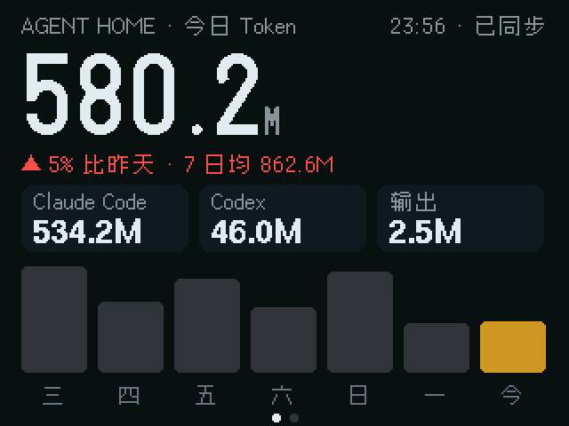
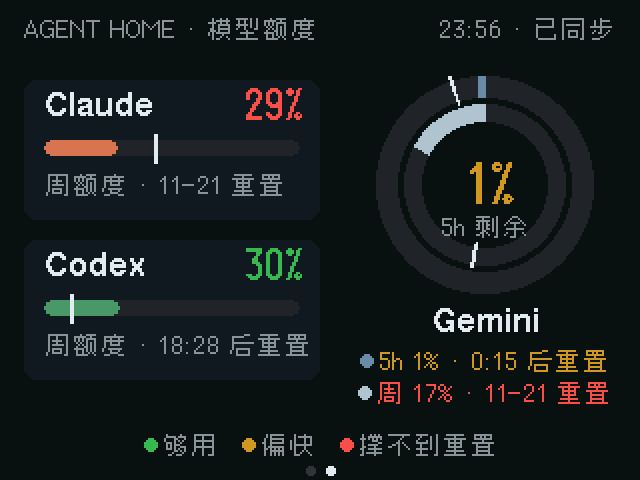

# AgentHome ESP32

[English](README.md) | 简体中文

放在桌上的 2.8 寸小屏：显示 Claude Code / Codex 今天用了多少 Token，以及 Claude、Codex、Gemini 订阅额度还剩多少，并用颜色告诉你撑不撑得到下次重置。

额度数据来自 **[AgentHome](https://github.com/PeterChen1997/agenthome)**：一个本地 macOS App，帮你永久归档 Claude Code / Codex / Gemini 的会话，统计 Token、费用和额度。本仓库是它的硬件伴侣。

| 今日 Token | 模型额度 |
|---|---|
|  |  |

截图是用 `tools/screenshot.py`（需要 Pillow）直接从板子显存读出来的。点一下屏幕翻页。

## 显示内容

**第 1 页 · 今日 Token**：今日总量（输入 + 输出 + 缓存写 + 缓存读）、比昨天、7 日均、Claude Code / Codex / 输出分项、7 天柱状图。

**第 2 页 · 模型额度**
- Claude、Codex：只显示周额度（Pro 会员真正卡的是周额度），横条是剩余。
- Gemini：双层环，外圈 5 小时额度，内圈周额度。彩色是剩余，已用从 12 点方向起顺时针扣。
- **百分比数字的颜色 = 紧张程度**：按目前速度推算到重置时会用掉多少（已用 % ÷ 窗口已过时间比例）。
  🟢 不到 90% 够用 · 🟡 90%–110% 偏快 · 🔴 超过 110% 撑不到重置。窗口刚开始（过去不到 10%）推不准，显示白色。
- **白色竖线**：按时间平均分配的话，现在应该还剩多少。彩色部分没到这根线，就是用得比时间快。

## 硬件

- **LCDwiki ES3C28P**：ESP32-S3（16MB Flash、8MB PSRAM）+ 2.8 寸 ILI9341 320×240 IPS 屏 + FT6336 电容触摸。USB-C 连 Mac，不需要 Wi-Fi。
- 其他 ESP32-S3 + ILI9341 的板子也能用：改 `firmware/agent-home/agent-home.ino` 顶部的引脚定义即可。固件会写入厂家的 IPS gamma 表（`applyVendorPanelTuning`），TN 屏可以去掉这段。整屏画布要 150KB，需要带 PSRAM 的板子。

## 烧录固件

需要 [arduino-cli](https://arduino.github.io/arduino-cli/)、`esp32:esp32` 核心（测试版本 3.3.11）、Arduino 库 `GFX Library for Arduino`（1.6.7）和 `U8g2`（2.36）。

```bash
arduino-cli core install esp32:esp32
arduino-cli lib install "GFX Library for Arduino" U8g2
cd firmware/agent-home
arduino-cli compile --upload -p $(ls /dev/cu.usbmodem* | head -1) \
  --fqbn "esp32:esp32:esp32s3:CDCOnBoot=cdc,FlashSize=16M,PSRAM=opi" .
```

连不上时手动进下载模式：按住 BOOT，短按 RST，松开 BOOT，再烧一次。

## Mac 端推送

`tools/push_usage.py`（Python 3.10+，只用标准库）读本机日志，每 60 秒通过 USB 串口给板子推几行文本。每次推完就关闭串口，烧录时不用停它。

```bash
python3 tools/push_usage.py --once --dry-run   # 只打印要推的内容
python3 tools/push_usage.py                    # 每 60 秒推一次
```

数据来源：

| 数据 | 来源 | 需要 AgentHome？ |
|---|---|---|
| Claude Code Token | `~/.claude/projects/**/*.jsonl` | 不需要 |
| Codex Token 和周额度 | `~/.codex/sessions/**/*.jsonl`（`rate_limits`） | 不需要 |
| Claude 周额度 | `~/AgentHome/signals/claude-usage.json` | **需要** |
| Gemini 5 小时 / 周额度 | `~/AgentHome/signals/agy-usage.json` | **需要** |

没装 [AgentHome](https://github.com/PeterChen1997/agenthome) 时，第 1 页和 Codex 额度照常显示，Claude、Gemini 显示「暂无额度数据」。AgentHome 每 15 分钟刷新一次额度，不消耗 Token。

常驻运行：改好 `tools/agenthome-esp32.plist` 里的路径，复制到 `~/Library/LaunchAgents/`，再 `launchctl bootstrap gui/$(id -u) ~/Library/LaunchAgents/agenthome-esp32.plist`。

脚本默认找 macOS 的 `/dev/cu.usbmodem*`；Linux 上加 `--port /dev/ttyACM0`。

## 串口协议

115200 波特率，一行一条，完整格式见 `agent-home.ino` 文件头注释。示例见英文 README。

## 隐私

全部在本地：脚本只读本机文件、写 USB 串口，不联网、不上报任何数据。

## 许可证

[Apache-2.0](LICENSE)
